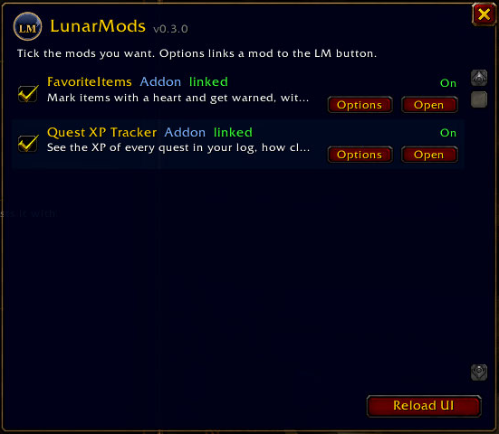
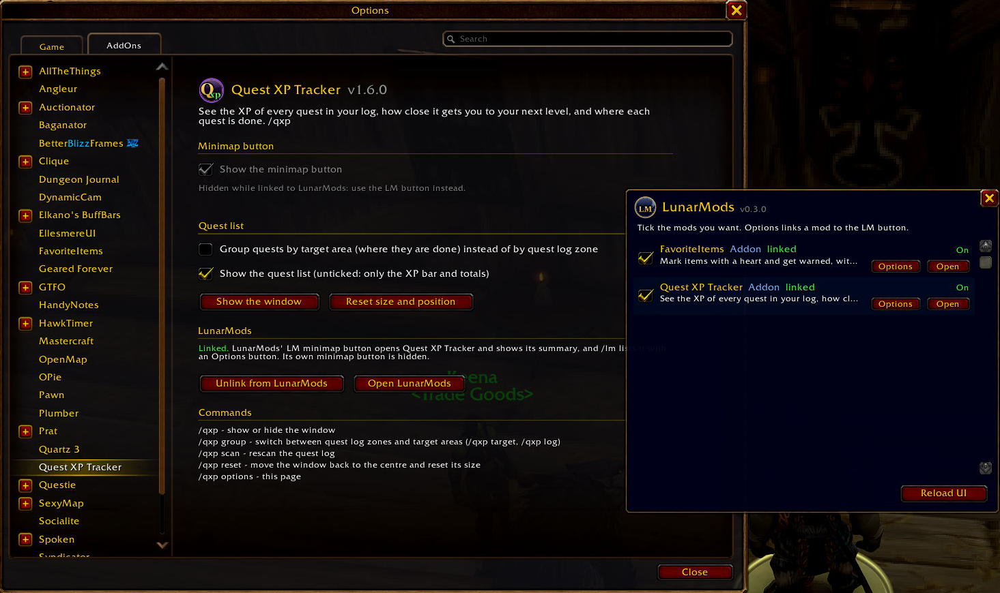
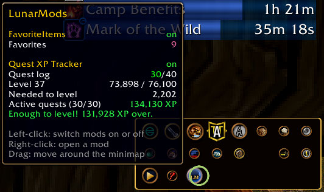

<p align="center"></p>

# LunarMods

**Switch all of Lundqwist's mods on and off in one list, and run the ones you link from one minimap button.**

Made for **World of Warcraft: Forever**. Type `/lm` or click the round **LM** button on the minimap.



## The mods

Each mod is its own addon, in its own repository with its own download. They all work without LunarMods.

| Mod | What it does |
|---|---|
| **[FavoriteItems](https://github.com/Lundqwist/FavoriteItems)** | Mark items with a heart and get warned, with a buy-back button, when you sell one. `/fav` |
| **[Quest XP Tracker](https://github.com/Lundqwist/WoW_Forever_QuestXPTracker)** | See the XP of every quest in your log, how close it gets you to your next level, and where each quest is done. `/qxp` |

## Switch mods on and off

The `/lm` window lists every one of the mods you have installed:

- **Tick or untick** a mod to switch it on or off. The mods are separate addons, so this takes effect after **Reload UI**. The window tells you when a reload is needed.
- **Open** opens the mod (the same as `/fav` or `/qxp`).
- **Options** opens the mod's own options page, where you link it to LunarMods.
- Your choices are the same for all your characters.

## Link a mod: one minimap button for all of them

On its own, every mod has its own minimap button. Its options page (right-click its minimap button, click **Options** in `/lm`, or find it under the game's Options → AddOns) has a **Link to LunarMods** button:

- **Linked**: the mod's own minimap button goes away. The **LM** button's right-click menu opens it, and its tooltip shows what the mod has to tell you (Quest XP Tracker's XP summary, the number of favorites).
- **Not linked**: the mod keeps its own minimap button, and LunarMods only switches it on and off.
- **Unlink from LunarMods**, on the same page, gives the mod its own button back. Without LunarMods, every mod simply works with its own button.





The **LM** button:

- **Hover**: every mod and whether it's on, plus the summary of each linked mod
- **Left-click**: open or close the list of mods
- **Right-click**: a menu to open any linked mod, or the list
- **Drag**: move it around the minimap (square minimaps such as SexyMap's work too)

LunarMods is also in the game's addon button by the minimap.

## Commands

| Command | What it does |
|---|---|
| `/lm` or `/lunarmods` | Open the list |
| `/lm list` | Show the mods and their state in chat |
| `/lm on <mod>`, `/lm off <mod>` | Switch a mod on or off, for example `/lm off favoriteitems` |
| `/lm link <mod>`, `/lm unlink <mod>` | Link a mod to the LM button, or give it its own minimap button again |
| `/lm minimap` | Show or hide the LM button |
| `/lm <mod> ...` | A mod's own commands, for example `/lm questxptracker group` |
| `/lm help` | The commands |

## Install

Unpack the zip into `World of Warcraft\_forever_\Interface\AddOns`, next to the mods you want from the table above.

---

# For developers

## Repositories

Every mod has its own repository; they sit next to each other:

```
E:\ProjectsCoding\
├── LunarMods\               this repository
│   ├── LunarMods\           the addon: the list, the LM minimap button, loading parts
│   ├── shared\              LunarLink.lua and install-mod.ps1, copied into each mod
│   ├── docs\                the CurseForge description, logo and screenshots; README.md is built from them
│   ├── templates\           the template for new parts
│   └── tools\               install, package, new part, icons, sync-link
├── FavoriteItems\           github.com/Lundqwist/FavoriteItems
└── QuestXPTracker\          github.com/Lundqwist/WoW_Forever_QuestXPTracker
```

## How a mod links to LunarMods

A mod carries a copy of `shared\LunarLink.lua`, loaded before its own Lua file, with `LunarMods` in `## OptionalDeps` so LunarMods loads first when it is there:

```
## OptionalDeps: LunarMods
## X-LunarMods: 1

LunarLink.lua
MyMod.lua
```

```lua
local ADDON_NAME, ns = ...
local link = ns.NewLunarLink({
    name    = ADDON_NAME,
    title   = "My Mod",
    icon    = "Interface\\AddOns\\MyMod\\Media\\Icon",
    db      = function() return MyModSettings end,  -- account-wide saved table
    open    = function() MyMod_Toggle() end,      -- left-click, and Open in /lm
    tooltip = function(tooltip) end,              -- summary lines (optional)
    options = function(link)                      -- extra settings (optional)
        link:AddHeader("My settings")
        link:AddCheckbox("Do the thing", function() return MyModSettings.thing end,
                                         function(on) MyModSettings.thing = on end)
    end,
    help    = { "/mm - open the window" },
})
-- at PLAYER_LOGIN:
link:Init()
```

That gives the mod its own minimap button, an options page under the game's Options → AddOns, and the **Link to LunarMods** button on that page. `link:Init()` calls `LunarMods:RegisterMod(name, handle)` when LunarMods is loaded. A linked mod hides its own minimap button; LunarMods then puts it in the LM button's menu and tooltip. `link:OpenOptions()` opens the page (`/fav options`, `/qxp options`).

Edit LunarLink.lua only in `shared\`, then copy it out and commit the copy in each mod's repository:

```powershell
.\tools\sync-link.ps1
```

## How LunarMods finds mods

An **addon** is listed when its `.toc` file has `## X-LunarMods: 1` or `## Author: Lundqwist`. `## X-LunarMods-Open: /qxp` gives it an Open button even before it registers. Addons are switched on or off through the game's own AddOn list (for all characters), so a change takes effect at the next reload.

A **part** is a small addon folder named `LunarMods_Something` with three extra lines in its `.toc` file. Parts always count as linked:

```
## Dependencies: LunarMods
## LoadOnDemand: 1
## X-LunarMods-Part: 1
```

`LoadOnDemand` tells the game not to load the part by itself. At login LunarMods loads the parts that are ticked in its list; ticking one later loads it right away. Unticking stops it; it leaves memory at the next `/reload`.

## Make a new part

```powershell
.\tools\new-part.ps1 -Name SellJunk -Notes "Sells grey items when you open a vendor."
.\tools\install.ps1
```

That creates `LunarMods_SellJunk` from the template and links it into the game. Type `/reload` and it is in the `/lm` list. Then write the part in `LunarMods_SellJunk\SellJunk.lua`:

```lua
local part = LunarMods:NewPart(...)      -- "..." holds the folder name

function part:OnEnable()                 -- switched on: at login or when ticked
    self:RegisterEvent("MERCHANT_SHOW")
end

function part:MERCHANT_SHOW()            -- an event calls the method with its name
    self:Print("a vendor!")
end

function part:OnDisable() end            -- optional: hide frames, stop timers
function part:OnSlash(message) end       -- optional: /lm selljunk <message>
```

What a part gets from LunarMods:

| | |
|---|---|
| `part:OnEnable()`, `part:OnDisable()` | Called when the part is switched on or off |
| `part:RegisterEvent(event [, handler])` | Listen to a game event. Removed automatically when the part is switched off |
| `part:UnregisterEvent(event)` | Stop listening |
| `part:OnSlash(message)` | Receives `/lm <part> message` |
| `part:Print(...)` | A chat line with the part's name in front |
| `part.db` | A table saved between sessions, shared by all characters |
| `part.chardb` | The same, for this character only |
| `part:IsEnabled()` | Whether the part is switched on |

An error in one part is reported in the normal way and does not stop the other parts.

## Tools

```powershell
.\tools\install.ps1            # link LunarMods (and any parts) into the game; an older real copy is moved to AddOns-backup-<date>
.\tools\install.ps1 -Remove    # take the links away again
.\tools\package.ps1            # build README.md and dist\LunarMods-<version>.zip
.\tools\build-readme.ps1       # only rebuild README.md from docs\
.\tools\sync-link.ps1          # copy shared\LunarLink.lua into FavoriteItems and QuestXPTracker
.\tools\make-icon.ps1 -Size 64 -Tga LunarMods\Media\LMIcon.tga    # the LM icon
```

Each mod's repository has its own `install.ps1` (a copy of `shared\install-mod.ps1`) that links that mod into the game.

The game's folder is `World of Warcraft\_forever_\Interface\AddOns`; pass `-AddOns <path>` to the install scripts if yours is somewhere else.

## License

[MIT](LICENSE) © 2026 Bjarne Lundqwist
